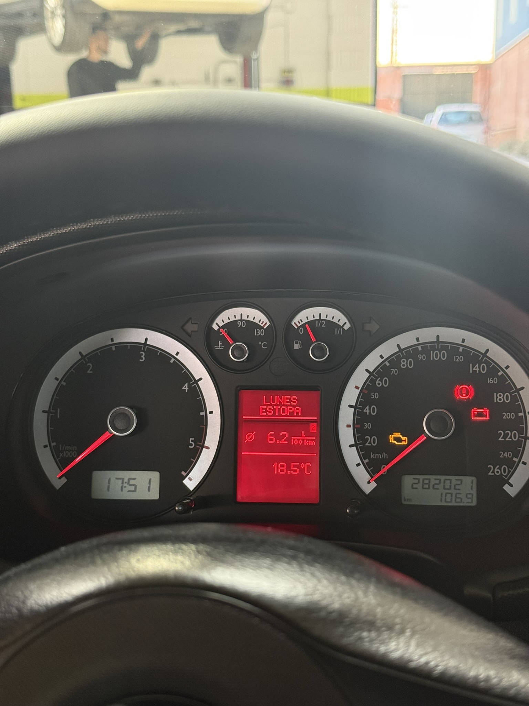
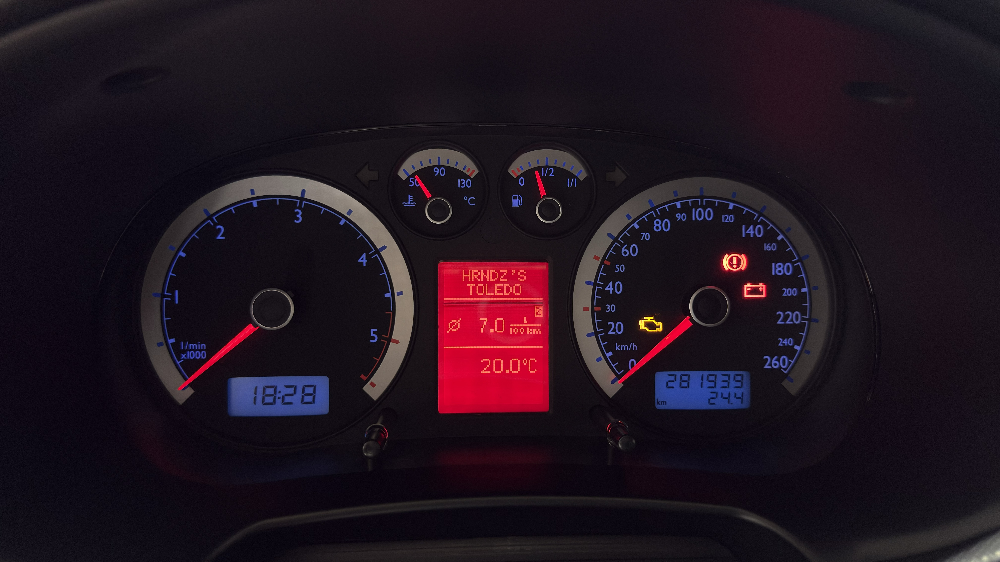
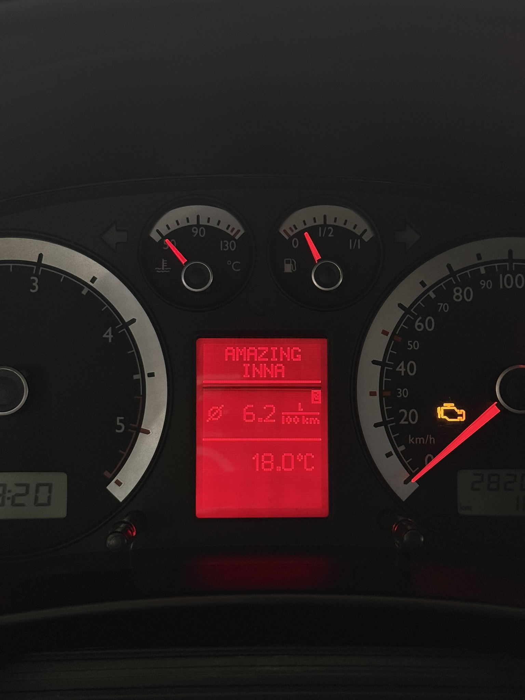
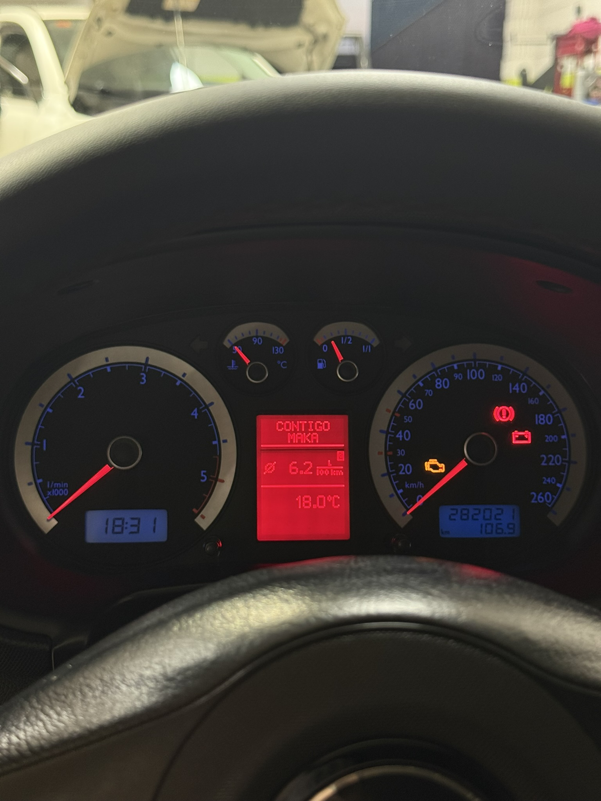

<p align="right"><a href="README.md">English</a> · <b>Español</b></p>

# FIS Now Playing

Muestra el **título y el artista de la canción que suena en tu iPhone** (Spotify, Apple Music…) en la zona de radio del display FIS/DIS de un cuadro de instrumentos del grupo VAG, como lo haría un RNS-E de fábrica.

Hecho y probado en un **Seat Toledo 1M2 1.9 TDI (2004)** con **cuadro de Golf IV 1J5 920 846 CX**, comunicándose con el cuadro por el bus **3LB / TLB**.

<p align="center">
  
</p>

<!-- VÍDEO: arrastra aquí tu MP4 en el editor web de GitHub; se convertirá en reproductor -->

https://github.com/user-attachments/assets/0f4be0f8-19d8-4622-a68f-13174e4bf2d0

---

## Introducción

Esta idea nace de querer tener en el propio cuadro de instrumentos del coche (en mi caso, un cuadro de Golf IV) la **información de la canción que está sonando: título y artista**.

Estos cuadros no reciben esa información, ni siquiera con un CD original. Además, yo escucho la música por Bluetooth mediante un módulo externo que engaña a la radio haciéndole creer que tiene un cargador de CDs, así que en el cuadro siempre aparecía lo mismo: `TRACK 1` / `CD 1`.

Con lo que he desarrollado, como se puede ver en las fotos y vídeos, la zona de radio del FIS muestra el **título y el artista** de lo que suena en el iPhone, un mensaje cuando la música está **en pausa** y un mensaje de reposo cuando el móvil **no está conectado**, para que la parte superior del FIS nunca se quede en negro. No hace falta instalar ni abrir ninguna app en el móvil, y vale para Spotify, Apple Music o cualquier app que aparezca en *Ahora suena*. La idea es que parezca algo que el coche traía de fábrica.

## Cómo funciona

```
iPhone ──BLE (Apple Media Service)──► ESP32 ──UART "TITULO|ARTISTA\n"──► Arduino Nano ──3LB──► Cuadro FIS
```

1. El **ESP32** aparece en el iPhone como un accesorio Bluetooth llamado `FIS-NowPlaying` y se suscribe a **Apple Media Service (AMS)**, que publica la información de *Ahora suena* de la app que esté reproduciendo. No hace falta ninguna app en el móvil.
2. Cuando cambia la canción o el estado de reproducción/pausa, envía una línea `TITULO|ARTISTA` al Nano por serie (115200 baudios).
3. El **Arduino Nano** dibuja el título (línea 1) y el artista (línea 2) en la zona de radio con **TLBFISLib**.

El audio no forma parte de este proyecto: en mi coche va por un módulo Bluetooth en la radio original.

## Qué se ve en el cuadro

| Situación | Línea 1 | Línea 2 |
|---|---|---|
| Reproduciendo | Título | Artista |
| Texto de más de 8 caracteres | Hace scroll **una vez** de principio a fin, vuelve al principio y se queda quieto | |
| En pausa | `PAUSE` | |
| Al reanudar | `NOW` | `PLAYING` (3 s) y luego vuelve la canción |
| Pausa de más de 45 s, iPhone desconectado o 15 s sin datos | Mensaje de reposo (personalizable) | |
| Emparejando | `PIN` | Código de 6 cifras |

Las letras con tilde (á, é, ñ, ü…) se convierten a mayúsculas sin tilde, y se quita el añadido ` • Vídeo disponible` que a veces pone Spotify en el artista.

## Hardware

| Pieza | Notas |
|---|---|
| ESP32 DevKit (ESP32-WROOM-32) | Vale cualquier placa WROOM-32 |
| Arduino Nano (ATmega328P) | Un Uno R3 funciona igual |
| Alimentación de 5 V | Reductor desde 12 V con contacto |
| Cuadro VAG con FIS/DIS y 3LB | Probado: 1J5 920 846 CX (Golf IV, VDO) |

## Conexionado

**Nano → cuadro (3LB)** — SPI por hardware, como en los ejemplos de TLBFISLib:

| Nano | Línea 3LB |
|---|---|
| D9 | ENA |
| D13 (SCK) | CLK |
| D11 (MOSI) | DATA |
| GND | Masa |

**ESP32 → Nano** — en un solo sentido, así que no hace falta adaptador de nivel (el Nano lee los 3,3 V del ESP32 como nivel alto):

| ESP32 | Nano |
|---|---|
| GPIO17 (TX2) | D0 (RX) |
| GND | GND |

> ⚠️ Desconecta el cable de **D0** mientras cargas el sketch en el Nano por USB.

<!-- Añade aquí la imagen del esquema:  -->

## Software

### ESP32 — [`firmware/FIS_NowPlaying_ESP32`](firmware/FIS_NowPlaying_ESP32)
- IDE de Arduino, placa **ESP32 Dev Module**.
- Core **esp32 de Espressif Systems 3.2.1**. Las versiones 3.3.x y 2.0.x no son compatibles.
- Sin librerías extra: usa el BLE que trae el core.

### Arduino Nano — [`firmware/FIS_NowPlaying_Nano`](firmware/FIS_NowPlaying_Nano)
- Placa **Arduino Nano**.
- Librería [TLBFISLib](https://github.com/domnulvlad/TLBFISLib): *Code → Download ZIP* y después *Programa → Incluir librería → Añadir biblioteca .ZIP*.

### Primer emparejamiento

1. Alimenta todo y abre el monitor serie del ESP32 (115200).
2. En el iPhone: *Ajustes → Bluetooth → FIS-NowPlaying*.
3. Escribe el PIN que aparece en el cuadro (y en el monitor serie).
4. Pon algo: el título y el artista aparecen en el cuadro.

Si el emparejamiento se queda atascado, pulsa *Omitir este dispositivo* en el iPhone y vuelve a emparejar (y, si hace falta, borra la flash del ESP32).

### Personalización

En `FIS_NowPlaying_Nano.ino`:
- `IDLE_LINE0` / `IDLE_LINE1` — mensaje de reposo (máx. 8 caracteres por línea).
- `SCROLL_STEP_MS`, `SCROLL_HOLD_MS`, `SCROLL_END_HOLD_MS` — velocidad y pausas del scroll.

En `FIS_NowPlaying_ESP32.ino`:
- `DEVICE_NAME` — nombre Bluetooth.
- `PAUSE_CLEAR_MS`, `NOW_PLAYING_MS` — cuánto tarda en salir el mensaje de reposo tras pausar y cuánto se muestra `NOW PLAYING`.

## Galería

| | | |
|---|---|---|
|  |  |  |

## Autor

**Alberto Hernández López** — [@albertobikee](https://github.com/albertobikee)

## Agradecimientos

Este proyecto no existiría sin:

- **[TLBFISLib](https://github.com/domnulvlad/TLBFISLib)** de **[domnulvlad](https://github.com/domnulvlad)** — la librería que controla el FIS/DIS por 3LB. El firmware del Nano parte de su ejemplo `09.Radio_text`.
- **[MusicStation](https://github.com/ralihachev/MusicStation)** de **[ralihachev](https://github.com/ralihachev)** — el cliente de Apple Media Service, el emparejamiento con iOS y la configuración HID del firmware del ESP32 se basan en su código.

Y, por extensión, a [Tomáš Kováčik](https://github.com/tomaskovacik) (VAGFISWriter) y a la comunidad del Golf IV por toda la documentación sobre estos cuadros.

## Licencia

[GPL-3.0](LICENSE), la misma que TLBFISLib. Las partes basadas en MusicStation están además bajo su licencia MIT original © Roman Likhachev; el aviso se conserva en la cabecera de `FIS_NowPlaying_ESP32.ino`.

## Aviso

Proyecto personal, sin relación con SEAT, Volkswagen, Apple ni Spotify. Conectar cosas a la instalación eléctrica y al cuadro de un coche es bajo tu responsabilidad.
