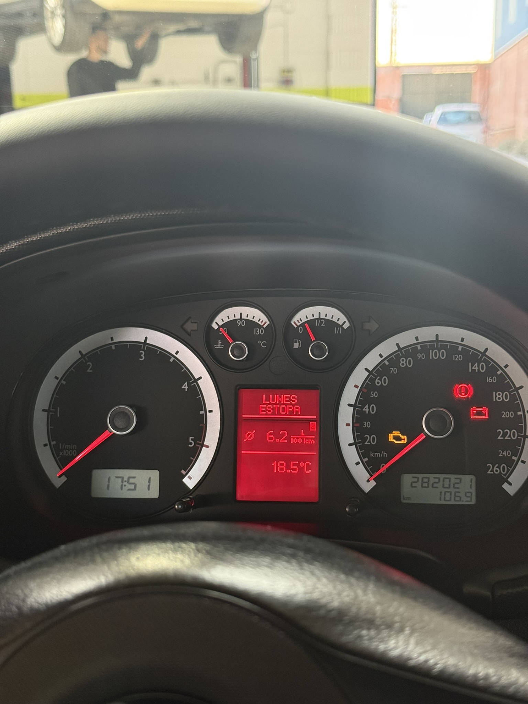
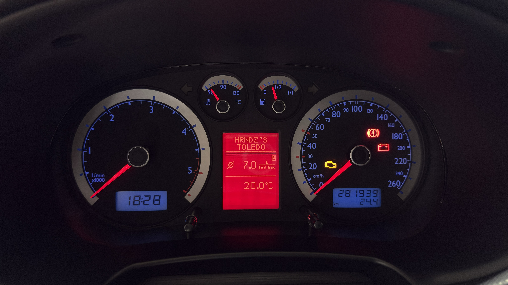
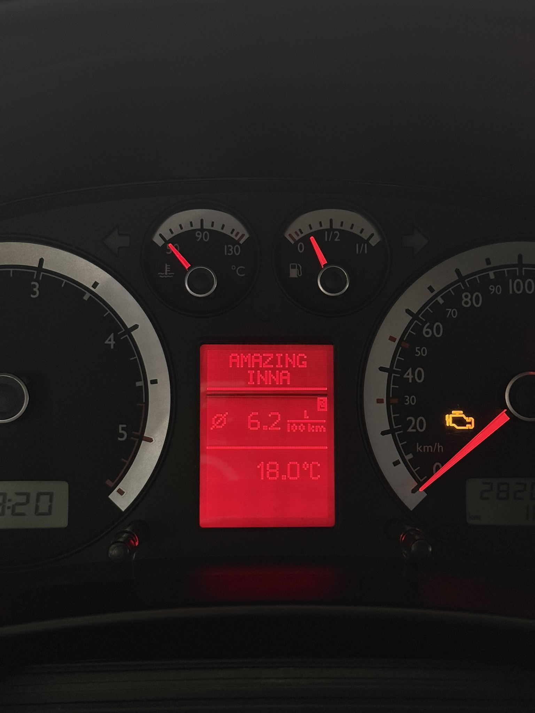
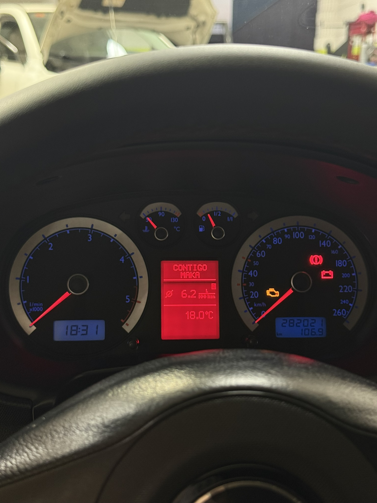

<p align="right"><b>English</b> · <a href="README.es.md">Español</a></p>

# FIS Now Playing

Show the **title and artist of the song playing on your iPhone** (Spotify, Apple Music…) in the radio area of the FIS/DIS display of a VAG instrument cluster, just like a factory RNS-E would.

Built and tested on a **Seat Toledo 1M2 1.9 TDI (2004)** fitted with a **Golf IV cluster 1J5 920 846 CX**, talking to the cluster over the **3LB / TLB** bus.

<p align="center">
  
</p>

<!-- VIDEO: drag your MP4 here in the GitHub web editor; it will turn into a player -->

https://github.com/user-attachments/assets/0f4be0f8-19d8-4622-a68f-13174e4bf2d0

---

## Background

This idea comes from wanting to see, on the car's own instrument cluster (in my case a Golf IV cluster), the **title and artist of the song that is playing**.

These clusters never receive that information, not even from an original CD. On top of that, I play music over Bluetooth through an external module that fools the radio into thinking a CD changer is connected, so the cluster always showed the same thing: `TRACK 1` / `CD 1`.

With this project, as you can see in the photos and videos, the radio area of the FIS now shows the **title and artist** of whatever is playing on the iPhone, a message when playback is **paused**, and an idle message when the phone is **not connected**, so the top part of the FIS never stays blank. There is no app to install or open on the phone, and it works with Spotify, Apple Music or any other app that shows in *Now Playing*. The aim is for it to look like something the car came with from the factory.

## How it works

```
iPhone ──BLE (Apple Media Service)──► ESP32 ──UART "TITLE|ARTIST\n"──► Arduino Nano ──3LB──► FIS cluster
```

1. The **ESP32** shows up on the iPhone as a Bluetooth accessory called `FIS-NowPlaying` and subscribes to **Apple Media Service (AMS)**, which publishes the *Now Playing* info of whatever app is playing. No app needed on the phone.
2. When the track or the play/pause state changes, it sends a line `TITLE|ARTIST` to the Nano over serial (115200 baud).
3. The **Arduino Nano** draws title (line 1) and artist (line 2) in the radio area using **TLBFISLib**.

Audio is not part of this project: in my car it goes through a Bluetooth module on the original radio.

## What you see on the cluster

| Situation | Line 1 | Line 2 |
|---|---|---|
| Playing | Title | Artist |
| Text longer than 8 characters | Scrolls **once** start to end, then returns to the start and stays still | |
| Paused | `PAUSE` | |
| Resumed | `NOW` | `PLAYING` (3 s), then the song again |
| Paused > 45 s, iPhone disconnected or no data for 15 s | Idle message (customisable) | |
| Pairing | `PIN` | 6-digit code |

Accented letters (á, é, ñ, ü…) are converted to plain uppercase letters, and the ` • Video available` suffix that Spotify sometimes adds to the artist is removed.

## Hardware

| Part | Notes |
|---|---|
| ESP32 DevKit (ESP32-WROOM-32) | Any WROOM-32 board |
| Arduino Nano (ATmega328P) | An Uno R3 works the same |
| 5 V supply | Step-down from switched 12 V (ignition) |
| VAG cluster with FIS/DIS and 3LB | Tested: 1J5 920 846 CX (Golf IV, VDO) |

## Wiring

**Nano → cluster (3LB)** — hardware SPI, as in the TLBFISLib examples:

| Nano | 3LB line |
|---|---|
| D9 | ENA |
| D13 (SCK) | CLK |
| D11 (MOSI) | DATA |
| GND | Ground |

**ESP32 → Nano** — one direction only, so no level shifter is needed (the Nano reads the ESP32's 3.3 V as a logic high):

| ESP32 | Nano |
|---|---|
| GPIO17 (TX2) | D0 (RX) |
| GND | GND |

> ⚠️ Disconnect the wire on **D0** while uploading the sketch to the Nano over USB.

<!-- Add the schematic image here:  -->

## Software

### ESP32 — [`firmware/FIS_NowPlaying_ESP32`](firmware/FIS_NowPlaying_ESP32)
- Arduino IDE, board **ESP32 Dev Module**.
- Core **esp32 by Espressif Systems 3.2.1**. Versions 3.3.x and 2.0.x are not supported.
- No extra libraries: it uses the BLE stack included in the core.

### Arduino Nano — [`firmware/FIS_NowPlaying_Nano`](firmware/FIS_NowPlaying_Nano)
- Board **Arduino Nano**.
- Library [TLBFISLib](https://github.com/domnulvlad/TLBFISLib): *Code → Download ZIP*, then *Sketch → Include Library → Add .ZIP Library*.

### First pairing

1. Power everything and open the serial monitor of the ESP32 (115200).
2. On the iPhone: *Settings → Bluetooth → FIS-NowPlaying*.
3. Enter the PIN shown on the cluster (and in the serial monitor).
4. Play something: title and artist appear on the cluster.

If pairing gets stuck, choose *Forget This Device* on the iPhone and pair again (erase the ESP32 flash if needed).

### Customisation

In `FIS_NowPlaying_Nano.ino`:
- `IDLE_LINE0` / `IDLE_LINE1` — idle message (max. 8 characters per line).
- `SCROLL_STEP_MS`, `SCROLL_HOLD_MS`, `SCROLL_END_HOLD_MS` — scroll speed and pauses.

In `FIS_NowPlaying_ESP32.ino`:
- `DEVICE_NAME` — Bluetooth name.
- `PAUSE_CLEAR_MS`, `NOW_PLAYING_MS` — how long until the idle message after pausing, and how long `NOW PLAYING` is shown.

## Gallery

| | | |
|---|---|---|
|  |  |  |

## Author

**Alberto Hernández López** — [@albertobikee](https://github.com/albertobikee)

## Acknowledgements

This project would not exist without:

- **[TLBFISLib](https://github.com/domnulvlad/TLBFISLib)** by **[domnulvlad](https://github.com/domnulvlad)** — the library that drives the FIS/DIS over 3LB. The Nano firmware is based on its `09.Radio_text` example.
- **[MusicStation](https://github.com/ralihachev/MusicStation)** by **[ralihachev](https://github.com/ralihachev)** — the ESP32 firmware's Apple Media Service client, iOS pairing and HID setup are based on its code.

And, by extension, to [Tomáš Kováčik](https://github.com/tomaskovacik) (VAGFISWriter) and the Golf IV community for all the documentation on these clusters.

## License

[GPL-3.0](LICENSE), the same as TLBFISLib. The portions based on MusicStation are also under its original MIT license © Roman Likhachev; the notice is kept in the header of `FIS_NowPlaying_ESP32.ino`.

## Disclaimer

Hobby project, not affiliated with SEAT, Volkswagen, Apple or Spotify. Wiring into a car's electrical system and instrument cluster is at your own risk.
